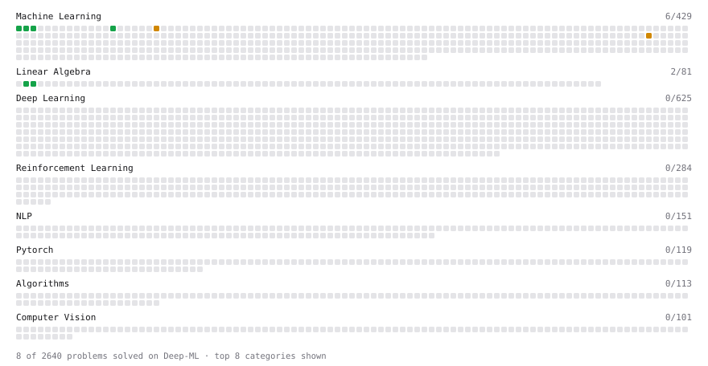

# Deep-ML

My machine learning practice from [Deep-ML](https://www.deep-ml.com). Every solution here was written by hand.

**13** solved · 13 problems · 0 labs · 0 math

[**Browse the interactive portfolio**](https://meiyunaa.github.io/deep-ml/) to replay this filling in over time.

## Problems

| | Difficulty | Solved | |
| --- | --- | --- | --- |
| [Binary Classification with Logistic Regression](https://www.deep-ml.com/problems/104) | easy | 2026-11-26 | [solution](problems/0104-binary-classification-with-logistic-regression) |
| [Feature Scaling Implementation](https://www.deep-ml.com/problems/16) | easy | 2026-11-26 | [solution](problems/0016-feature-scaling-implementation) |
| [Implement Ridge Regression Loss Function](https://www.deep-ml.com/problems/43) | easy | 2026-11-26 | [solution](problems/0043-implement-ridge-regression-loss-function) |
| [Linear Regression Using Gradient Descent](https://www.deep-ml.com/problems/15) | easy | 2026-11-24 | [solution](problems/0015-linear-regression-using-gradient-descent) |
| [Linear Regression Using Normal Equation](https://www.deep-ml.com/problems/14) | easy | 2026-11-24 | [solution](problems/0014-linear-regression-using-normal-equation) |
| [One-Hot Encoding of Nominal Values](https://www.deep-ml.com/problems/34) | easy | 2026-11-26 | [solution](problems/0034-one-hot-encoding-of-nominal-values) |
| [Reshape Matrix](https://www.deep-ml.com/problems/3) | easy | 2026-11-09 | [solution](problems/0003-reshape-matrix) |
| [Single Neuron](https://www.deep-ml.com/problems/24) | easy | 2026-11-26 | [solution](problems/0024-single-neuron) |
| [Transpose of a Matrix](https://www.deep-ml.com/problems/2) | easy | 2026-11-09 | [solution](problems/0002-transpose-of-a-matrix) |
| [Implement Gradient Descent Variants with MSE Loss](https://www.deep-ml.com/problems/47) | medium | 2026-11-24 | [solution](problems/0047-implement-gradient-descent-variants-with-mse-loss) |
| [Implement K-Nearest Neighbors](https://www.deep-ml.com/problems/173) | medium | 2026-11-26 | [solution](problems/0173-implement-k-nearest-neighbors) |
| [K-Means Clustering](https://www.deep-ml.com/problems/17) | medium | 2026-11-26 | [solution](problems/0017-k-means-clustering) |
| [Stochastic Gradient Descent Step for Linear Regression](https://www.deep-ml.com/problems/802) | medium | 2026-11-24 | [solution](problems/0802-stochastic-gradient-descent-step-for-linear-regression) |

---

_This file is regenerated by Deep-ML on every push._
